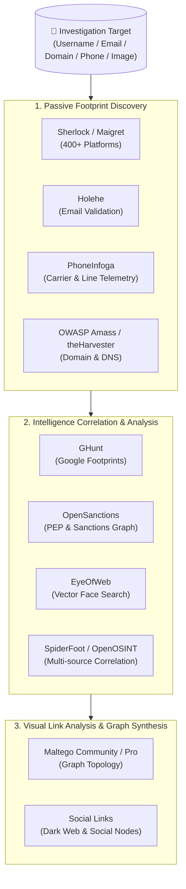

# 🕵️‍♂️ Awesome Open Source Intelligence (OSINT)

  
  
  
  
  
  

  

**A curated, SEO-indexed directory of leading commercial SaaS platforms and premier open-source GitHub projects for Open Source Intelligence (OSINT), attack surface reconnaissance, digital footprints, and identity correlation.**

*Last updated: 2026 • Curated for threat intelligence analysts, cyber investigators, privacy researchers, and compliance teams.*

---

## 📑 Table of Contents
- [🌟 Overview & SEO Taxonomy](#-overview--seo-taxonomy)
- [📊 Sector Overview & Market Dynamics](#-sector-overview--market-dynamics)
- [🏢 Enterprise SaaS & Hosted Platforms](#-enterprise-saas--hosted-platforms)
- [💻 Open-Source GitHub Projects](#-open-source-github-projects)
- [🛠️ Investigation Architecture & Custom Stacks](#️-investigation-architecture--custom-stacks)
- [🤝 How to Contribute](#-how-to-contribute)
- [💖 Support & Community](#-support--community)
- [⚖️ Legal Compliance & Ethical Disclaimer](#️-legal-compliance--ethical-disclaimer)
- [📈 Star History](#-star-history)

---

## 🌟 Overview & SEO Taxonomy

**Open Source Intelligence (OSINT)** is the systematic discipline of gathering, analyzing, and synthesizing publicly accessible data—such as social media profiles, domain registrations, breach leaks, DNS records, public court records, sanctions watchlists, and satellite metadata—into actionable threat intelligence and evidence.

### 🔍 Key Investigation Domains
* **Identity Resolution & Enumeration**: Cross-platform username detection, email-to-service validation, phone carrier tracing, and alias mapping.
* **Attack Surface Management & Reconnaissance**: Subdomain brute-forcing, certificate transparency tracking, port telemetry, and web crawler harvesting.
* **Breach & Threat Correlation**: Ingestion of compromised credentials, past breach telemetry, and dark web forum exposures.
* **Graph & Link Analytics**: Visualizing complex entity networks, shell companies, PEP relationships, and criminal associations.
* **Facial Intelligence & Multimodal AI**: High-dimensional vector searches across publicly indexed images and social video platforms.

---

## 📊 Sector Overview & Market Dynamics

The global **Open Source Intelligence (OSINT)** market was valued between **$12.1 Billion and $19.5 Billion in 2025** and is projected to expand to **$21 Billion–$22.3 Billion in 2026**, on track to eclipse **$36.5 Billion by 2032** at an impressive Compound Annual Growth Rate (CAGR) of **15% to 26%**. This swift expansion is accelerated by escalating geopolitical tensions, the proliferation of state-sponsored cyber warfare, and the integration of automated Generative AI and vector search into intelligence operations.

In terms of structure, the sector is **moderately to highly fragmented** rather than a winner-take-all monopoly. While diversified multi-billion dollar information giants like **Thomson Reuters** and **RELX (LexisNexis)** dominate public-records and legal due diligence, specialized intelligence vendors (such as **Maltego**, **Babel Street**, **Clearview AI**, and **Social Links**) capture defense, cyber forensics, and dark web niches. Concurrently, a vibrant community of **open-source CLI frameworks** continuously decentralizes core collection methodologies, preventing singular vendor lock-in.

---

## 🏢 Enterprise SaaS & Hosted Platforms

The following commercial SaaS solutions represent the leading enterprise platforms in OSINT, identity resolution, risk screening, and social graph analysis. 

*Table sorted descending by **Company Size (Revenue / Valuation)**:*

| 🏢 Platform / Vendor | 🎯 Core OSINT Focus & Capabilities | 📈 Company Size (Revenue / Valuation) | 💵 Starting Tier Pricing | 🎁 Free Tier / Trial Limits |
| :--- | :--- | :--- | :--- | :--- |
| **[Thomson Reuters CLEAR](https://www.thomsonreuters.com/en/products-services/risk-fraud-intelligence/clear.html)** | Enterprise public records aggregation, criminal history, corporate ownership, and real-time risk scoring for fraud and compliance. | **~$80.5 Billion Market Cap** *(~$7.0B Annual Revenue)* | **$45.00 / user / month** *(Baseline add-on tier; standard investigative seats start at ~$150.00 / user / month via annual contract)* | **0 Days Free Tier** *(No self-serve free plan; 7-day to 14-day supervised proof-of-concept trial available only for vetted enterprise & government agencies post-sales demo)* |
| **[LexisNexis Accurint](https://risk.lexisnexis.com/products/accurint-for-government)** | Billions of public and proprietary records, identity verification, deep skip-tracing, and Relavint™ graph link analysis. | **~$78.0 Billion Market Cap (RELX)** *(~$4.5B Annual Revenue in Risk Solutions)* | **$80.00 - $100.00 / user / month** *(Flat-rate entry; or pay-per-search from $0.35/query with a $100.00/month account minimum commitment)* | **0 Days Free Tier** *(No permanent free tier; 7-day trial with capped lookups [10–25 queries] granted exclusively upon strict verification of permissible statutory purpose)* |
| **[Maltego](https://www.maltego.com/)** | Interactive graph-based link analysis, entity transform hub (Shodan, AlienVault, Whois, social networks), and attack surface mapping. | **~$150 Million+ Valuation** *(~$25M+ ARR; backed by Charlesbank)* | **€999.00 / user / year** *(~$89.00 / month billed annually for Maltego Pro)* | **Free Forever Tier (Maltego CE)** *(Community Edition is 100% free forever; limited to max 12 entities per transform return and 10,000 entities per graph for non-commercial use)* |
| **[Clearview AI](https://www.clearview.ai/)** | Algorithmic facial recognition search engine indexed against 50+ billion scraped surface-web images for suspect identification. | **~$130 Million Valuation (Series B)** *(~$8.4M Annual Revenue)* | **$6,500.00 / year** *(~$541.67 / month for entry-level single-seat municipal agency license)* | **0 Days Free Tier** *(No public free plan; 14-day to 30-day restricted pilot evaluation with capped searches provided strictly to verified law enforcement & public safety personnel)* |
| **[Babel Street Insights](https://www.babelstreet.com/)** *(formerly Babel X)* | Cross-lingual threat intelligence, AI-driven entity and name matching (Rosette), and persistent social media monitoring across 30+ languages. | **~$100 Million+ Valuation** *(~$31.7M Annual Revenue)* | **$1,000.00 / user / month** *($12,000.00 / year GSA base seat bundling 300 concurrent terms & 1M docs/month)* | **5-Day Free Trial (Babel Street Match)** *(5-day access to AI name matching engine with pre-loaded OFAC SDN dataset; 0-day free tier for core Babel Insights)* |
| **[Social Links](https://sociallinks.io/)** *(SL Pro & Crimewall)* | Deep social media profiling (500+ sources), dark web threat monitoring, blockchain transaction tracing, and Maltego integration transforms. | **~$25 Million - $35 Million Valuation** *(~$7.0M ARR; venture-backed)* | **€4,000.00 / user / year** *(~$360.00 / month billed annually for SL Professional)* | **Free Forever Tier (Social Links CE)** *(Social Links Community Edition gives ~5% features, capped at 12–24 results per transform for non-commercial research; or 14-day Pro trial with 500 transforms)* |
| **[ShadowDragon](https://shadowdragon.io/)** *(Horizon & SocialNet)* | Real-time social cyber footprint tracking, alias correlation, threat actor pattern of life, and breach event monitoring. | **~$15 Million - $25 Million Valuation** *(~$5.0M Annual Revenue)* | **£5,500.00 / user / year** *(~$590.00 / month billed annually for single-seat Horizon + SocialNet license)* | **0 Days Free Tier** *(No core software free tier; provides free standalone web dork utilities forever; offers 7-day to 14-day supervised trial for accredited corporate security teams)* |

---

## 💻 Open-Source GitHub Projects

Open-source OSINT projects offer transparency, auditable code, local data custody, and independence from commercial vendor constraints.

*Repositories sorted descending by **GitHub Star Count**:*

1. **[Sherlock](https://github.com/sherlock-project/sherlock)**   
   🔍 **The undisputed standard for username enumeration across 400+ social platforms.**  
   * **Installation**: `pip install sherlock-project`  
   * **Key Capabilities**: Blazing fast HTTP concurrency checking account existence across major social networks, forums, and developer sites. Ideal first pass for discovering target handles.

2. **[Maigret](https://github.com/soxoj/maigret)**   
   🕵️‍♂️ **Deep profile dossier generator searching across 3,000+ websites.**  
   * **Installation**: `pip install maigret`  
   * **Key Capabilities**: Advanced Sherlock evolutionary fork extracting avatar hashes, bio details, connected social IDs, and generating comprehensive HTML graph reports.

3. **[Social Analyzer](https://github.com/qeeqbox/social-analyzer)**   
   🌐 **API, CLI, and Web App for analyzing profile footprints across 1,000+ platforms.**  
   * **Installation**: `docker run -p 9005:9005 qeeqbox/social-analyzer`  
   * **Key Capabilities**: Multi-layered search including string match, regex profile pattern extraction, web GUI inspection, and exportable JSON outputs.

4. **[SpiderFoot](https://github.com/smicallef/spiderfoot)**   
   🕷️ **Automated open-source intelligence reconnaissance engine with 200+ modules.**  
   * **Installation**: `git clone https://github.com/smicallef/spiderfoot && pip install -r requirements.txt`  
   * **Key Capabilities**: Orchestrates queries across DNS, WHOIS, web servers, breach data, and threat feeds against target IPs, domains, emails, and usernames.

5. **[GHunt](https://github.com/mxrch/GHunt)**   
   📡 **Offensive OSINT framework targeting Google accounts, IDs, and cloud footprints.**  
   * **Installation**: `pipx install ghunt`  
   * **Key Capabilities**: Extracts Google account owner name, Gaia ID, Google Plus photos, active Google services, Maps reviews, calendar public events, and Android device types.

6. **[PhoneInfoga](https://github.com/sundowndev/phoneinfoga)**   
   📞 **Advanced phone number reconnaissance and metadata extraction.**  
   * **Installation**: `docker run -it -p 5000:5000 sundowndev/phoneinfoga`  
   * **Key Capabilities**: Validates international number formats, identifies carrier, country, and line type (VoIP/Mobile/Landline), and automates search engine dorking footprints.

7. **[theHarvester](https://github.com/laramies/theHarvester)**   
   🌾 **Domain-focused email, employee name, subdomain, and host reconnaissance.**  
   * **Installation**: `git clone https://github.com/laramies/theHarvester && pip install -r requirements/base.txt`  
   * **Key Capabilities**: Collects internet attack surface assets by parsing search engine queries, PGP servers, Certificate Transparency logs, and public APIs.

8. **[OWASP Amass](https://github.com/owasp-amass/amass)**   
   🛡️ **In-depth network attack surface mapping and external asset discovery.**  
   * **Installation**: `go install -v github.com/owasp-amass/amass/v4/...@master`  
   * **Key Capabilities**: Industry standard for enterprise external perimeter discovery, recursive DNS brute forcing, BGP routing analysis, and active graph graph database storage.

9. **[Holehe](https://github.com/megadose/holehe)**   
   📧 **Email-to-registered-account enumeration without notifying target users.**  
   * **Installation**: `pip install holehe`  
   * **Key Capabilities**: Leverages password-reset forgot-password logic across 120+ top web services (GitHub, Twitter, Spotify, Discord) to confirm account registration.

10. **[Photon](https://github.com/s0md3v/Photon)**   
    ⚡ **Hyper-fast, multi-threaded OSINT web crawler and data extractor.**  
    * **Installation**: `git clone https://github.com/s0md3v/Photon && pip install -r requirements.txt`  
    * **Key Capabilities**: Crawls target URLs at high speeds to harvest emails, social media handles, internal URLs, files (PDFs, docs), and API endpoints.

11. **[Sublist3r](https://github.com/aboul3la/Sublist3r)**   
    🔎 **Fast subdomain enumeration tool leveraging passive search engine indexing.**  
    * **Installation**: `pip install sublist3r`  
    * **Key Capabilities**: Queries Baidu, Yahoo, Google, Bing, Ask, Netcraft, and Virustotal to uncover hidden subdomains and expanded infrastructure perimeters.

12. **[Blackbird](https://github.com/antoniaci/blackbird)**   
    🦅 **High-speed account search across 500+ platforms by username and email.**  
    * **Installation**: `pip install -r requirements.txt`  
    * **Key Capabilities**: Async Python lookup, built-in metadata scraping, exportable visual web report, and automated PDF dossier export.

13. **[Recon-ng](https://github.com/lanmaster53/recon-ng)**   
    🧰 **Full-featured modular reconnaissance framework with database persistence.**  
    * **Installation**: `git clone https://github.com/lanmaster53/recon-ng && pip install -r REQUIREMENTS`  
    * **Key Capabilities**: Command structure mirroring Metasploit, modular marketplace, built-in SQLite backend, and standardized reporting transforms.

14. **[OpenOSINT](https://github.com/OpenOSINT/OpenOSINT)**   
    🤖 **AI-augmented unified OSINT framework unifying multiple standalone CLI utilities.**  
    * **Installation**: `pip install openosint`  
    * **Key Capabilities**: Bundles Sherlock, Holehe, theHarvester, and PhoneInfoga into a cohesive interactive REPL console with a modern local web UI.

15. **[OpenSanctions](https://github.com/opensanctions/opensanctions)**   
    🏛️ **The global open database of sanctions, PEPs, and watchlist entities.**  
    * **Installation**: `pip install opensanctions` / `pip install yente-client`  
    * **Key Capabilities**: Aggregates 460+ global government watchlists (2M+ entities) updated 4 times daily into FollowTheMoney graph data models; includes an MCP server for AI agent workflows.

16. **[Metagoofil](https://github.com/opsdisk/metagoofil)**   
    📄 **Metadata harvesting tool extracting usernames, software versions, and paths from public documents.**  
    * **Installation**: `git clone https://github.com/opsdisk/metagoofil && pip install -r requirements.txt`  
    * **Key Capabilities**: Searches Google for target domain PDFs, DOCX, XLSX, and PPTX files, downloads them, and inspects EXIF metadata for internal usernames and workstations.

17. **[EyeOfWeb](https://github.com/MehmetYukselSekeroglu/eye_of_web)**   
    👤 **Open-source facial intelligence and face similarity search platform.**  
    * **Installation**: `docker compose up --build`  
    * **Key Capabilities**: InsightFace AntelopeV2 model generating 512-dim facial embeddings, Milvus vector database indexing for millisecond ANN search across billions of faces, and full local data custody.

---

## 🛠️ Investigation Architecture & Custom Stacks

---

## 🤝 How to Contribute

We actively welcome contributions from the OSINT, threat intelligence, and cybersecurity communities!

1. 🍴 **Fork the repository**.
2. 🌿 **Create a new branch**: `git checkout -b feature/add-osint-tool`.
3. 📝 **Add or update the tool**:
   * Add the link, description, and key capabilities.
   * Ensure open-source entries include the proper Shields.io badge: ``
   * Verify commercial SaaS entries adhere to transparent pricing and verified company size metrics.
4. 🚀 **Commit and submit a Pull Request** with a concise summary.

---

## ⚖️ Legal Compliance & Ethical Disclaimer

> [!IMPORTANT]
> **Lawful and Authorized Use Only**
> This repository is maintained strictly for legitimate security research, asset defense, threat intelligence, law enforcement, and journalistic investigations.

* **Ethical Boundaries**: Doxxing, harassment, unauthorized stalking, and violating individual privacy rights are illegal and unethical.
* **Service Terms**: Scraping and automated querying may violate specific service Terms of Service (ToS); users must understand their local statutory jurisdictions (e.g., GDPR, CFAA, KVKK).
* **Zero Liability**: The maintainers and contributors assume no liability for misuse of any tools or datasets listed herein. Always adhere to legal counsel and authorized rules of engagement.

---

## 💖 Support & Community

Thank you for exploring and utilizing this curated Open Source Intelligence (OSINT) resource! If this project assisted your investigations, red teaming, security research, or compliance workflow, please consider showing your support:

* ⭐ **Star this repository** to help other security researchers and investigators discover it.
* 🍴 **Fork the repo** to contribute new OSINT tools, update platform pricing, or suggest improvements.
* 📢 **Share with peers**, your threat intelligence team, or on your social/professional networks.
* ☕ **Buy Me a Coffee / Sponsor**: Consider supporting ongoing maintenance and curation via the **[GitHub Sponsors Dashboard](https://github.com/sponsors/ishandutta2007)**. Every contribution directly empowers independent open-source cybersecurity curation!

  
  

---

## 📈 Star History

---

  Maintained with ❤️ by <a href="https://github.com/ishandutta2007">Ishan Dutta</a> and the Global Cybersecurity Community.

